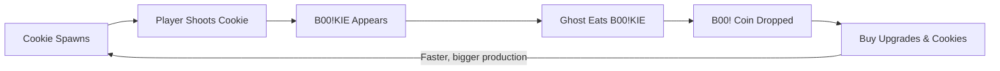

## Developer & Contributions
**Dicco** (Game Designer, Programmer & Pixel Artist)

## About
BOO!KIES is a 2D pixel-art incremental game where you shoot cookies to turn them into B00!KIES for hungry ghosts to eat. Well-fed ghosts reward you with B00! Coins, which you spend on upgrades and on unlocking new cookie variants. Click fast, build up your cookie production, and watch the numbers climb.

<br>

## Key Features

**Shoot Cookies, Make B00!KIES**: Cookies launch from the bottom of the screen in a parabolic arc on a cooldown. Click one to shoot it and it becomes a B00!KIE.

**Hungry Ghost System**: Ghosts roam the screen, pathfind to the nearest B00!KIE, eat it and drop B00! Coins. The more B00!KIES you make, the more coins you earn.

**Upgrades**: Spend B00! Coins on five upgrades that speed up production: Batter, Batch, Glaze, Cutter and Ovenspread. Each upgrade gets more expensive as you buy it.

**Cookie Variants**: Unlock new cookies, each with its own gimmick and a bigger B00!KIE payout, from the starting Chocolate Chip Cookie to the 3-hit Red Velvet Cookie.

<table>
<tr>
<td align="center" width="50%">
<strong>Shooting Cookies</strong><br>
Click cookies to turn them into B00!KIES

</td>
<td align="center" width="50%">
<strong>Ghosts & Upgrades</strong><br>
Ghosts eat B00!KIES and drop B00! Coins for upgrades

</td>
</tr>
</table>

## Core Loop


## Layer / Module Design
```mermaid
---
config:
  theme: neutral
  look: neo
---
graph TD
    subgraph "Core Gameplay"
        CS[Cookie Spawner]
        SS[Shooting System]
        BK[B00!KIE]
    end

    subgraph "Ghost & Economy"
        GS[Ghost System]
        CUR[Currency System]
    end

    subgraph "Progression"
        UP[Upgrades]
        CV[Cookie Variants]
    end

    subgraph "UI Systems"
        CoinUI[Coin Counter]
        UpUI[Upgrades Panel]
        CookieUI[Cookie Variants Panel]
    end

    CS --> SS
    SS --> BK
    BK --> GS
    GS --> CUR
    CUR --> UP
    CUR --> CV
    UP --> CS
    UP --> SS
    UP --> BK
    CV --> CS

    CUR --> CoinUI
    UP --> UpUI
    CV --> CookieUI

    classDef coreStyle fill:#e1f5fe,stroke:#01579b,stroke-width:2px
    classDef ghostStyle fill:#e8f5e8,stroke:#1b5e20,stroke-width:2px
    classDef progStyle fill:#fff3e0,stroke:#e65100,stroke-width:2px
    classDef uiStyle fill:#f3e5f5,stroke:#4a148c,stroke-width:2px

    class CS,SS,BK coreStyle
    class GS,CUR ghostStyle
    class UP,CV progStyle
    class CoinUI,UpUI,CookieUI uiStyle
```

## Modules and Features

The incremental shooting, ghost AI, economy and upgrade gameplay is powered by a small Unity C# system.

| 📂 Name | 🎬 Scene | 📋 Responsibility |
|---------|----------|-------------------|
| **Cookie Spawner** | **Gameplay** | - Spawn cookies from the bottom of the screen on a cooldown<br/>- Launch them on a parabolic trajectory<br/>- Apply cooldown and multishot upgrades<br/>- Spawn the unlocked cookie variants |
| **Shooting System** | **Gameplay** | - Detect player clicks on cookies<br/>- Apply shoot radius and turret upgrades<br/>- Report hits to the B00!KIE system |
| **B00!KIE** | **Gameplay** | - Spawn B00!KIES when a cookie is shot<br/>- Roll the chance for golden B00!KIES<br/>- Spawn the amount set by the cookie variant |
| **Ghost System** | **Gameplay** | - Roam ghosts around the screen<br/>- Pathfind to the nearest B00!KIE<br/>- Play eating animation<br/>- Drop B00! Coins after eating |
| **Currency System** | **Gameplay** | - Track and display B00! Coins<br/>- Add coins from ghosts and spend them on upgrades and cookies |
| **Upgrades** | **Gameplay** | - Hold upgrade levels and costs<br/>- Calculate cost with the growth formula<br/>- Apply upgrade effects to spawning, shooting and B00!KIES |
| **Cookie Variants** | **Gameplay** | - Define each cookie's behavior, hits and B00!KIE drop<br/>- Handle unlocking with B00! Coins |

<br>

## Game Flow Chart
```mermaid
---
config:
  theme: redux
  look: neo
---
flowchart TD
  start([Game Start])
  start --> spawn[Cookie Spawns in Arc]
  spawn --> click{Player Clicks Cookie?}

  click -->|Yes| hit[Cookie Shot]
  click -->|No| fall[Cookie Falls]
  fall --> spawn

  hit --> multi{Multishot Chance?}
  multi -->|Yes| double[Spawn 2 Cookies]
  multi -->|No| make[Make B00!KIE]
  double --> make

  make --> golden{Golden Chance?}
  golden -->|Yes| gold[Golden B00!KIE]
  golden -->|No| normal[Normal B00!KIE]

  gold --> ghost[Nearest Ghost Pathfinds]
  normal --> ghost
  ghost --> eat[Ghost Eats B00!KIE]
  eat --> coin[Drop B00! Coins]

  coin --> shop{Spend Coins?}
  shop -->|Upgrade| upgrade[Buy Upgrade]
  shop -->|Cookie| unlock[Unlock Cookie Variant]
  shop -->|Save| spawn
  upgrade --> spawn
  unlock --> spawn
```

<br>

## Upgrades
Upgrade cost uses the formula `cost_next = cost_base × (growth_rate ^ owned)`.

| Upgrade | Effect | Cost Base | Growth Rate | Max Level |
|---------|--------|-----------|-------------|-----------|
| **Batter** | Decrease cookie cooldown by 0.1 seconds | 10 | 1.2 | 25 |
| **Batch** | Increase multishot chance (2 cookies at once) by 5% | 50 | 1.24 | 15 |
| **Glaze** | Increase golden B00!KIE chance by 5% | 100 | 1.26 | 10 |
| **Cutter** | A turret that shoots cookie cutters | 1000 | 1.5 | 10 |
| **Ovenspread** | Increase shooting radius by 1 unit | 5000 | 2 | 3 |

| Stat | Minimum | Maximum |
|------|---------|---------|
| Cooldown | 0.5 s | 3 s |
| Multishot Chance | 0% | 75% |
| Golden B00!KIE Chance | 0% | 50% |
| Turret Amount | 0 | 10 |
| Shoot Radius | 2 | 5 |

## Cookie Variants

| Cookie | Gimmick | Base B00!KIE Drop | Cost |
|--------|---------|-------------------|------|
| **Chocolate Chip Cookie** | The starting cookie, 1 hit to shoot | 1 | 0 |
| **Double Chocolate** | When shot, turns into a Chocolate Chip Cookie | 3 | 100 |
| **Sugar Cookie** | Fast cookie | 5 | 5,000 |
| **Mint Chocolate Cookie** | When shot, splits into two smaller mint chocolate cookies | 3 + 2 + 2 | 10,000 |
| **Red Velvet Cookie** | 3 hits to shoot | 10 | 50,000 |

## Progression

| Stage | Time | Unlocks |
|-------|------|---------|
| Early | 0 - 10 minutes | Basic upgrades, Double Chocolate Cookie and Sugar Cookie |
| Mid | 11 - 25 minutes | Most upgrades, all cookies |

## Art Direction
- **Dimension:** 2D
- **Style:** Pixel art
- **Resolution / pixel size:** 32 x 32
- **Setting:** A haunted night scene with pine trees, a haunted castle, clouds and moon, seen through a window frame with a television

<br>

## Play The Game
<a href="https://YOUR-ITCH-LINK-HERE">Play Now on itch.io</a>

<br>

## Installation & Setup
1. Clone this repository
2. Open the project in Unity
3. Open the main gameplay scene
4. Press Play to start testing

## Controls
- **Left Click** - Shoot a cookie
- **Mouse** - Navigate upgrade and cookie menus

## Credits
- Engine: Unity
- Pixel art: Aseprite (made by the developer)
- Audio: Pixabay and free asset packs
